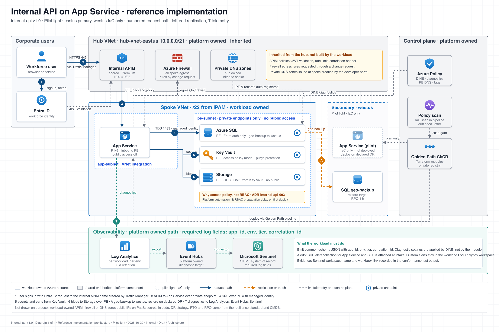

# ArchWeave

**Turn system intent into architecture.**

ArchWeave is an agent skill that turns a plain-language prompt into a static, house-styled architecture diagram: an SVG the agent writes by hand, a zero-dependency checker that refuses sloppy output, and a PNG rendered locally by the browser already on your laptop. No interactive viewer, no cloud render service, nothing leaves the machine.

It was built for enterprise architecture teams who need diagrams that say what is unique about *their* platform (which hub, which shared gateway, which owner, which DR strategy) rather than restating vendor documentation.



## What you get

- **Five diagram types.** Architecture (zones, hub and spoke, private endpoints, regions), sequence, workflow (owner lanes, gates, removed hand-offs), dataflow, lifecycle.
- **A vocabulary file** that holds your organization's component names, positions, owners, DR strategies and pattern IDs. Edit one file, every diagram follows.
- **Authoring rules and SVG conventions** the agent reads before drawing: color means ownership, numbered request paths, metadata stamp, legend, no invented facts.
- **A checker** (`check-diagram.py`, Python 3.9+, standard library only) that validates the plan, matches every planned node, zone and edge to the SVG, blocks scripts, event handlers, SMIL, entities and every external or file reference, estimates text overflow, and requires the metadata stamp.
- **Local renderers** for Windows (headless Edge or Chrome), macOS and Linux (rsvg or headless Chrome).
- **A 40-symbol icon library** (`assets/icons.xml`, plain SVG markup) of simplified glyphs, so output needs no vendor assets.
- **Light and dark themes.** Default light; set `meta.theme` to `dark` (or just ask) for dark slides. Same layout, same icons, dark palette, checked by the checker.
- **A prompt cookbook** (`references/prompt-cookbook.md`) with worked prompts for a dozen common technology diagrams.
- **Six worked examples** that pass the checker: internal API architecture by DR strategy, API request sequence, Golden Path workflow, each in light and dark.
- **Three hosts from one source:** VS Code GitHub Copilot agent mode or Claude Code (the agent runs the whole loop), Microsoft 365 Copilot custom skills (the checker runs in Copilot's sandbox, Frontier preview), and Microsoft 365 Copilot with knowledge files (the agent writes the SVG, a local script finishes it).

## How it works

```
prompt  ->  classify type  ->  plan.json  ->  hand-authored SVG  ->  check  ->  render PNG  ->  look  ->  repair
```

The agent plans in JSON against a small schema, draws the SVG using the shared icon defs, runs the checker until it exits zero, renders, looks at its own PNG, and repairs. Three repair rounds, then it reports what remains.

## Install

**From the release zip** (the skill only, SKILL.md at the zip root): download `archweave-skill.zip` from the [latest release](https://github.com/mrobinson2/archweave/releases/latest) and unzip it into the skills folder your host reads.

```bash
# VS Code GitHub Copilot: inside the repository where diagrams will live
curl -L -o archweave-skill.zip https://github.com/mrobinson2/archweave/releases/latest/download/archweave-skill.zip
mkdir -p .github/skills/archweave && unzip -q archweave-skill.zip -d .github/skills/archweave

# Claude Code, personal install
mkdir -p ~/.claude/skills/archweave && unzip -q archweave-skill.zip -d ~/.claude/skills/archweave
```

Check the download against `archweave-skill.zip.sha256` from the same release. The zip does not include the Microsoft 365 Copilot files under `m365/`; clone the repository for those.

**Microsoft 365 Copilot custom skill** (Agent Builder, Frontier preview): download `archweave-skill-agent-builder.zip` from the same release and upload it under Configure, Skills, Add. It is the same skill packaged to Microsoft's upload rules. See `INSTRUCTIONS.md` section 6.

**From source** (everything, including `m365/` and the docs). In this repository the skill folder is `skills/archweave/` so it is easy to browse; the hosts look in `.github/skills/` (VS Code Copilot) and `~/.claude/skills/` (Claude Code), so copy it there or use the zip:

```bash
git clone https://github.com/mrobinson2/archweave.git
```

## Quick start

```bash
cd archweave
python skills/archweave/scripts/check-diagram.py \
  skills/archweave/examples/architecture-internal-api/plan.json \
  skills/archweave/examples/architecture-internal-api/internal-api.svg
skills/archweave/scripts/render-png.sh skills/archweave/examples/architecture-internal-api/internal-api.svg
```

Then open the repo in VS Code with GitHub Copilot agent mode (or Claude Code) and ask:

> Use archweave to draw the Warm standby deployment view for internal-api.

Full install, configuration and usage, including the Microsoft 365 Copilot route and how to replace the sample vocabulary with your own: **[INSTRUCTIONS.md](INSTRUCTIONS.md)**.

## Repository layout

```
skills/archweave/            the skill (SKILL.md, references, schemas, assets, examples, scripts)
m365/                        Microsoft 365 Copilot variant: instructions, manifest, local finisher
out/                         generated diagrams land here (git-ignored)
INSTRUCTIONS.md              install, configure, use
CHANGELOG.md
LICENSE                      MIT
THIRD_PARTY_NOTICES.md       Archify attribution, trademark notes
```

## Design principles

1. **The vocabulary is the product.** Generic diagrams are free from any vendor. The value is in the one file that says how your platform is actually arranged and who owns what.
2. **Static beats interactive for most enterprise use.** A PNG goes into a deck, a wiki, a PR, an ADR. It needs no runtime.
3. **The checker is the reviewer that never gets tired.** Overflowing labels, missing stamps and invented hostnames are caught before a human sees the diagram.
4. **Keep everything local.** Architecture diagrams carry internal hostnames and address ranges. Rendering happens on the laptop.

## Lineage

ArchWeave is a deliberately scaled-back cousin of [Archify](https://github.com/tt-a1i/archify) (MIT), which produces interactive HTML diagrams with a browser-based gate pipeline. ArchWeave keeps Archify's workflow and type router, replaces the renderer with hand-authored SVG, and adds the organization vocabulary layer. See `THIRD_PARTY_NOTICES.md`.

## License

MIT. See `LICENSE`.
